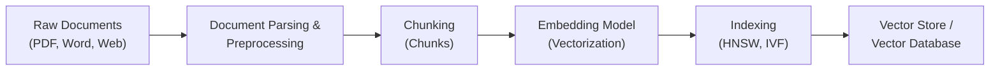
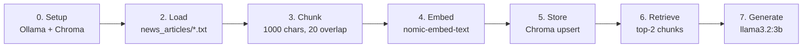

# RAG (Retrieval-Augmented Generation)

**RAG** stands for **Retrieval-Augmented Generation**. It is an AI architectural pattern that enhances Large Language Models (LLMs) by retrieving relevant information from external knowledge sources (e.g., vector databases, documents, APIs) before generating a response.

> 📍 Everything in these notes is implemented in [`app.py`](app.py) — a minimal, fully local RAG pipeline (Ollama `nomic-embed-text` + `llama3.2:3b`, ChromaDB) over the articles in `news_articles/`.

---

## Why RAG?
- **Reduces Hallucinations:** Grounds model answers in factual, verifiable source data.
- **Access to Private & Fresh Data:** Enables LLMs to answer questions using internal documents or real-time info without retraining.
- **Cost-Effective:** Avoids expensive model fine-tuning or continuous pre-training.

---

## How It Works

1. **Retrieve:** When a query is received, semantic search fetches the most relevant text chunks from a vector database or external data source.
2. **Augment:** The retrieved context is bundled alongside the user prompt.
3. **Generate:** The LLM uses both the provided context and its pre-trained reasoning to produce an accurate answer.

---

## Core Concepts & Data Pipeline
To build an effective RAG system, source knowledge must pass through an ingestion, vectorization, and indexing pipeline before it can be searched and retrieved.



---

### 1. Document Parsing and Preprocessing

- **Document Parsing:** The process of extracting raw text, structure, tables, images, and metadata from heterogeneous file formats (such as PDF, DOCX, HTML, Markdown, or scanned OCR files).
- **Preprocessing & Cleaning:** Transforming parsed text into a clean, uniform format. This includes:
  - Removing noise (headers, footers, page numbers, duplicate whitespace, boilerplate).
  - Preserving context and hierarchy (titles, markdown headings, list structures).
  - Enriching with metadata (author, creation date, source URL, section tags) to enable hybrid search and filtered retrieval.

> **💡 Simple Example:**
> - **Raw Document (Messy PDF):**  
>   `"ACME Corp Handbook \n Page 12 of 100 \n\n 2.4 Vacation Policy \n Employees receive 20 days PTO..."`
> - **Parsed & Cleaned Output:**
>   ```json
>   {
>     "text": "Vacation Policy: Employees receive 20 days PTO annually.",
>     "metadata": { "source": "handbook.pdf", "page": 12, "department": "HR" }
>   }
>   ```
>   *(Header noise and page numbers are removed, while text content and key metadata are preserved).*

---

### 2. Chunks and Chunking

- **What are Chunks?**
  A **chunk** is a discrete, manageable segment of text extracted from a larger document. LLMs and embedding models have fixed context windows, and passing entire documents into an embedding model degrades semantic fidelity and retrieval precision.
- **What is Chunking?**
  **Chunking** is the strategy and technique used to break long documents into smaller chunks.
- **Common Chunking Strategies:**
  - **Fixed-size Chunking:** Splits text by character or token count (e.g., 500 tokens).
  - **Sentence / Paragraph Chunking:** Respects grammatical sentence or paragraph boundaries.
  - **Recursive Character Chunking:** Recursively splits by paragraphs (`\n\n`), newlines (`\n`), and spaces (` `) to keep semantically related sentences intact.
  - **Semantic Chunking:** Groups sentences dynamically based on embedding similarity thresholds.
  - **Chunk Overlap:** Retaining a small overlapping window (e.g., 10–20% / 50 tokens) between consecutive chunks to ensure context is not severed across boundaries.

> **💡 Simple Example:**  
> Given this 3-sentence document:  
> *"Paris is the capital of France. It is famous for the Eiffel Tower. The city hosts millions of tourists every year."*
> - **Chunk 1 (with overlap):** `"Paris is the capital of France. It is famous for the Eiffel Tower."`
> - **Chunk 2 (with overlap):** `"It is famous for the Eiffel Tower. The city hosts millions of tourists every year."`  
> *(The repeated sentence keeps the topic connected across both chunks).*

---

### 3. Embeddings and LLM Embeddings

- **What is an Embedding?**
  An **embedding** is a numerical representation of data (text, images, audio) as a dense vector of floating-point numbers in a continuous multi-dimensional vector space (e.g., 384, 768, 1536, or 3072 dimensions).
- **What are LLM / Text Embeddings?**
  Text embeddings capture the **semantic meaning, intent, and contextual relationships** of words, sentences, or chunks.
  - Words or passages with similar meanings are positioned closer to each other in vector space (e.g., `"automobile"` and `"car"` have high cosine similarity).
  - Unlike simple keyword matching (like BM25), semantic embeddings can match queries to relevant documents even when they share no identical words.

> **💡 Simple Example:**  
> Imagine a simplified 3-dimensional embedding space:
> - `"dog"` $\rightarrow$ `[0.85, 0.20, 0.15]`
> - `"puppy"` $\rightarrow$ `[0.83, 0.22, 0.18]` *(nearly identical numbers $\rightarrow$ semantically very close)*
> - `"airplane"` $\rightarrow$ `[-0.72, 0.65, 0.90]` *(very different numbers $\rightarrow$ far apart)*
>
> In RAG, a user query like **"How do I fix login errors?"** will match a document chunk saying **"Troubleshooting authentication failures"** because their embedding vectors point in nearly the same direction.

---

### 4. Embedding Model and Vectorization

- **Embedding Model:**
  A specialized neural network specifically trained to map discrete inputs (text, images, audio, words) into dense numerical vector representations.
  - *Distinction from generative LLMs:* Generative LLMs predict subsequent tokens to generate text, whereas embedding models output a fixed-size vector summarizing the semantics of the input.
- **What is Vectorize (Vectorization)?**
  **Vectorizing** is the actual step of taking raw discrete inputs (text chunks, user queries, images, or audio snippets) and converting them into mathematical vectors using an embedding model.

#### Notable Embedding Models by Modality & Use Case

| Model | Modality | Primary Use Case | How It Works |
| :--- | :--- | :--- | :--- |
| **GloVe** *(Global Vectors)* | **Text (Word-level)** | Word analogies, vocabulary lookup, classic NLP. | Pre-transformer algorithm (Stanford) that learns static vector representations for individual words based on global co-occurrence statistics across a corpus. *(Note: static, so "bank" has the same vector whether it means a river bank or money bank).* |
| **Transformer Embeddings** *(SBERT, BGE, OpenAI)* | **Text (Sentence / Passage)** | Text RAG, semantic search, document retrieval, Q&A. | Contextual encoder models where the vector represents the meaning of the entire phrase or paragraph in context. |
| **CLIP** *(Contrastive Language-Image Pre-training)* | **Multimodal (Vision + Text)** | Text-to-image search, Multimodal RAG, image retrieval, zero-shot classification. | Dual-encoder network (OpenAI) that maps both images and text descriptions into the **same shared embedding space**. Allows you to search for images using natural language queries (e.g., querying `"sunset over mountains"` finds matching JPEG vectors). |
| **Wav2Vec / Wav2Vec 2.0** | **Audio (Speech / Sound)** | Speech recognition (ASR), voice RAG, audio similarity search, acoustic classification. | Self-supervised model (Meta) that operates directly on raw audio waveforms to create dense acoustic/phonetic vectors without needing transcriptions first. |

> **💡 Simple Example (Text Vectorization):**  
> ```python
> # this is my get_openai_embedding() from app.py — Ollama exposes an
> # OpenAI-compatible endpoint, so the normal openai client works locally
> client = OpenAI(api_key="ollama", base_url="http://localhost:11434/v1")
> 
> # Vectorizing a chunk using an embedding model (nomic-embed-text → 768 dims)
> text_chunk = "Antigravity is an AI coding assistant."
> response = client.embeddings.create(
>     model="nomic-embed-text",
>     input=text_chunk
> )
> 
> vector = response.data[0].embedding
> print(vector[:3])  # e.g., [-0.0182, 0.0341, -0.0094, ...] (768 float values)
> ```

> **💡 Simple Example (Multimodal with CLIP):**  
> An image of a Golden Retriever and the text `"a cute golden retriever dog playing"` are encoded by CLIP into two separate vectors. Because they share the same semantic space, calculating cosine similarity between the image vector and the text query vector yields a very high score (~0.92).

---

### 5. Vector Store vs. Vector Database

Although often used interchangeably, there is an important architectural distinction:

| Feature | Vector Store | Vector Database |
| :--- | :--- | :--- |
| **Definition** | A lightweight storage component or abstraction layer for holding vectors and chunk metadata. | A dedicated, full-featured database engine designed specifically for vector data. |
| **Persistence & Scale** | Often in-memory or file-based (e.g., FAISS index file, Chroma in-memory, basic KV store). | Distributed, horizontally scalable, persistent storage with ACID/eventual consistency. |
| **Enterprise Features** | Minimal (basic CRUD and search). | Real-time indexing, multi-tenancy, RBAC, backups, failover, metadata filtering, and hybrid search. |
| **Examples** | FAISS, Annoy, simple local stores. | Pinecone, Qdrant, Milvus, Weaviate, Chroma (persistent mode), `pgvector` (PostgreSQL). |

> **💡 Simple Example:**  
> - **Vector Store (Quick script / POC):** Saving vectors directly in an in-memory list or local `.bin` file using FAISS. Great for running experiments on a laptop, but crashes lose unsaved data and it lacks multi-user support.
> - **Vector Database (Production app):** Running a managed Qdrant or Pinecone cluster. If millions of users query and update documents concurrently, the database guarantees durability, security, metadata filtering (`WHERE department = 'HR'`), and high availability.

---

### 6. Indexing (Vector Indexing)

- **What is Indexing?**
  **Indexing** is the process of organizing and structuring stored vectors using specialized data structures and algorithms to allow ultra-fast similarity searches.
- **Why is Indexing necessary?**
  Without an index, finding the nearest neighbors to a query vector requires comparing it against every single vector in the database (brute-force k-NN / flat search, $O(N)$ complexity). As datasets scale to millions of vectors, flat searches become prohibitively slow.
- **Approximate Nearest Neighbor (ANN) Indexing Algorithms:**
  - **HNSW (Hierarchical Navigable Small World):** A multi-layer graph structure that enables logarithmic search time ($O(\log N)$) with state-of-the-art recall and speed.
  - **IVF (Inverted File Index):** Clusters vectors into Voronoi cells; at query time, only the closest centroid partitions are scanned.
  - **PQ (Product Quantization):** Compresses high-dimensional vectors to fit massive collections in RAM with minimal precision loss.
  - **Flat Index:** Computes exact cosine or Euclidean distance against all vectors; 100% recall but slower at large scale.

> **💡 Simple Analogy:**  
> - **Without Indexing (Flat search):** Searching for a topic in an encyclopaedia by reading every single page from page 1 to 10,000.  
> - **With Indexing (HNSW / ANN):** Using the book's index and table of contents to jump directly to the relevant chapter and section in seconds.

---

## Full Flow of `app.py` (step by step)



### 0. Setup — connect everything (runs on import)

```python
OLLAMA_URL = "http://localhost:11434/v1"          # Ollama's OpenAI-compatible endpoint

local_ef = embedding_functions.OpenAIEmbeddingFunction(
    api_key="ollama",                              # any non-empty string, nothing billed
    api_base=OLLAMA_URL,
    model_name="nomic-embed-text",                 # the embedding model
)

chroma_client = chromadb.PersistentClient(path="chroma_persistent_storage")
collection = chroma_client.get_or_create_collection(
    name="document_qa_collection_local",
    embedding_function=local_ef,                   # Chroma uses this to embed queries later
)

client = OpenAI(api_key="ollama", base_url=OLLAMA_URL)   # client for the chat model
```

**Why:** Chroma needs to know the embedding function *now* so that at query time it can embed the question in the **same vector space** as the chunks. `PersistentClient` = data survives restarts (stored as SQLite in `chroma_persistent_storage/`).

### 1. Sanity check — is Ollama + llama3.2:3b alive?

```python
response = client.chat.completions.create(
    model="llama3.2:3b",
    messages=[{"role": "user", "content": "Explain RAG in two sentences."}],
)
print(response.choices[0].message.content)
```

**Why:** fail fast — if this works, the chat model is reachable before doing the slow embedding work.

### 2. Load documents

```python
def load_documents_from_directory(directory_path):
    documents = []
    for filename in os.listdir(directory_path):
        if filename.endswith(".txt"):
            documents.append({"id": filename, "text": file.read()})
    return documents

documents = load_documents_from_directory("./news_articles")
# → [{"id": "05-03-databricks-acquires-....txt", "text": "..."}, ...]
```

### 3. Chunk

```python
def split_text(text, chunk_size=1000, chunk_overlap=20):
    chunks = []
    start = 0
    while start < len(text):
        end = start + chunk_size
        chunks.append(text[start:end])
        start = end - chunk_overlap          # next chunk starts 20 chars back
    return chunks

# for every document → chunks with ids "filename.txt_chunk_1", "filename.txt_chunk_2", ...
```

### 4. Embed every chunk

```python
def get_openai_embedding(text):
    response = client.embeddings.create(input=text, model="nomic-embed-text")
    return response.data[0].embedding        # 768-dim vector

doc["embedding"] = get_openai_embedding(doc["text"])
# → [{"id": ..., "text": chunk, "embedding": [0.01, -0.3, ...]}, ...]
```

### 5. Store in Chroma

```python
collection.upsert(ids=[doc["id"]], documents=[doc["text"]], embeddings=[doc["embedding"]])
# collection now holds [{id, chunk, embedding}, ...] and builds its HNSW index
```

**Why `upsert` not `insert`:** re-running the script overwrites the same ids instead of duplicating chunks.

### 6. Retrieve

```python
def query_documents(question, n_results=2):
    results = collection.query(query_texts=question, n_results=n_results)
    # flatten results["documents"] → [chunk1, chunk2]

relevant_chunks = query_documents("tell me about databricks")
```

**What happens inside:** Chroma embeds the question itself (using `local_ef` from step 0) and returns the 2 nearest chunks — that's the semantic search hitting the Databricks/Okera article.

### 7. Augment + Generate

```python
def generate_response(question, relevant_chunks):
    context = "\n\n".join(relevant_chunks)
    prompt = ("You are an assistant for question-answering tasks. Use the following pieces of "
              "retrieved context ... Use three sentences maximum ... "
              "\n\nContext:\n" + context)

    response = client.chat.completions.create(
        model="llama3.2:3b",
        messages=[
            {"role": "system", "content": prompt},      # ← the retrieved context
            {"role": "user", "content": question},
        ],
    )
    return response.choices[0].message.content
```

**This is the "Augment" step:** retrieved chunks go into the *system* prompt, the question stays as the *user* message, and the LLM answers grounded in the context.

> ⚠️ Key detail: chunks are embedded **manually** (step 4 → explicit `embeddings=`),
> while the query is embedded **by Chroma** (step 6 → `query_texts`). Both must
> use `nomic-embed-text` — different models = incompatible vector spaces = garbage retrieval.


